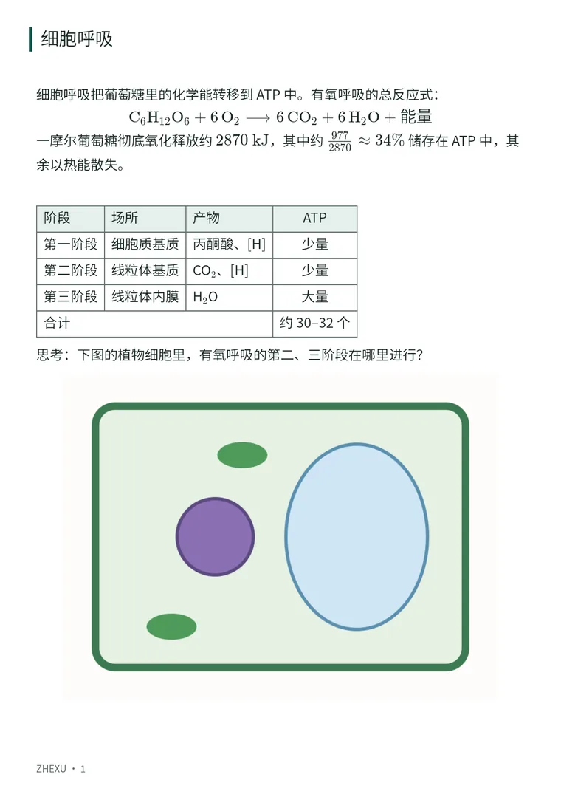
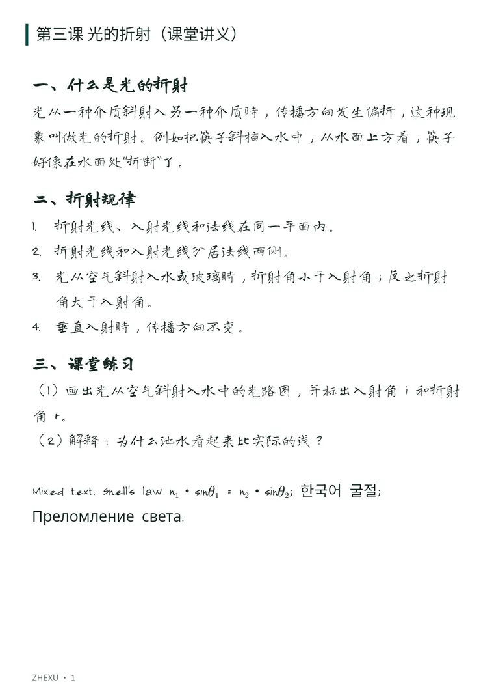
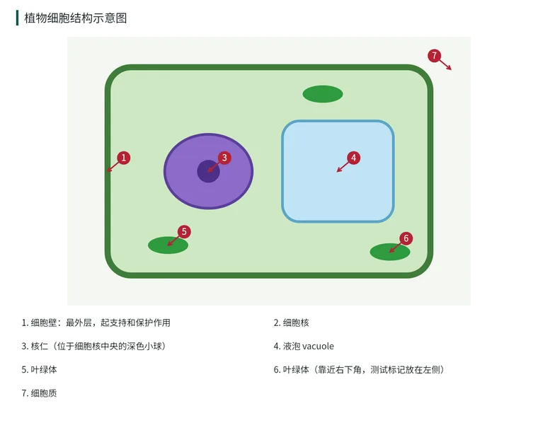

# 折序 ZHEXU

**一句话，展开成一堂课。**

折序是开源的 AI 互动课堂。说出想学什么，它先排好提纲，再做出课件，然后由 AI 老师讲解、AI 同学陪你讨论。

[English](/.github/README.md) | 简体中文

[](https://github.com/miscos330/zhexu/actions/workflows/zhexu-ci.yml)


## 基于 OpenMAIC

折序是 [OpenMAIC](https://github.com/THU-MAIC/OpenMAIC) 的下游版本。OpenMAIC 由 THU-MAIC 团队以 MIT 许可开源，课堂、课件和导出这些能力都来自上游。本仓库在上面加自己的品牌、主题和扩展。不是折序专用的改进会提交回上游，不留在这里。

本仓库原是 OpenMAIC 在 GitHub 上的 fork，2026-11-20 离开了 fork 网络，好让它在搜索里作为独立项目出现。提交历史没有变，跟上游的合并方式也照旧。给上游提的 pull request 改从另一个 fork [miscos330/OpenMAIC](https://github.com/miscos330/OpenMAIC) 发出。

上游的 README 原样保留在仓库根目录。[README-zh.md](/README-zh.md) 里有课堂的全部功能和各种配置方式。

## 现状

这是早期版本。最新的候选版本是 2026-11-21 的 [0.1.0-rc.2](https://github.com/miscos330/zhexu/releases/tag/zhexu-v0.1.0-rc.2)；每个版本改了什么见[变更记录](/extensions/zhexu/CHANGELOG.md)。

已经有：

- **课堂能力**：上游 OpenMAIC 的全部功能。
- **品牌和主题**：折序的标识、配色和深色模式。
- **扩展层**：新功能放在 [`extensions/`](/extensions/README.md) 下，只在上游代码里留几个很小的接入点，方便跟着上游升级。
- **A4 讲义**：助手把回答交付成真实文件，包括 A4 PDF 和页面图片，可选手写体。[实现方式](/extensions/README.md#a4-handouts-zhexu)。
- **图片标注**：助手查看你附上的图片，加上带编号的标注，导出 A4 的 PNG 和 PDF；原图不改动。[实现方式](/extensions/README.md#image-annotations-zhexu)。
- **我的文件**：侧栏里的一个页面，集中列出助手在各个对话里交付给你的讲义和标注图，可以直接下载，更早的可以一页一页往下加载。两个开关任意一个打开时可用。
- **课程讲义**：把你已经保存的一门课导出成 A4 讲义：每页上的文字、讲解和测验题按页排好，答案另起一页放在最后；内容原样取自课程，不经过模型改写。也可以只导出测验题，做成一份练习卷：顶部留姓名、班级和日期，简答题下面留出书写的空白，答案单独一页。和 A4 讲义共用同一个开关。
- **公式排版**：讲义里的 LaTeX 公式（行内写在 `\(` `\)` 之间，单独一行写在 `\[` `\]` 之间）和课程里的公式会排成正常的数学式，排法和字体与课件上的 KaTeX 相同。排不了的公式按 LaTeX 原文印出。[实现方式](/extensions/README.md#a4-handouts-zhexu)。
- **表格**：讲义里的 Markdown 表格（每行以 `|` 开头和结尾）和课程里的表格画成带线的表格：表头有底色，各列按设定对齐，长内容在格子里换行。合并单元格画成一个格子；长表格跨页时每页重复表头。[实现方式](/extensions/README.md#a4-handouts-zhexu)。
- **图片**：课程里的图片放进讲义，从这门课所属用户的课程素材里读取，不会去外网取图。放不进的图片会留下一行“图片未放入”的说明。[实现方式](/extensions/README.md#a4-handouts-zhexu)。
- **互动页和项目页**：课程里的互动页取出组件自带的说明（概念或任务、描述、步骤、概念图的节点），项目页取出项目描述、学习目标、各阶段和任务。页面本身的程序不印。
- **Markdown**：助手在讲义里写的标题、粗体和斜体、项目符号和编号列表、`---` 分隔线会排成对应的样式，没有空格的中文里也能正确识别。课程讲义的文字取自课程本身，原样印出。[实现方式](/extensions/README.md#a4-handouts-zhexu)。

这些功能默认关闭，由两个开关控制（`ZHEXU_DELIVERABLES_ENABLED`、`ZHEXU_IMAGE_ANNOTATIONS_ENABLED`）。它们有单元测试，也有[浏览器测试](/extensions/zhexu/e2e/README.md)：CI 会对着生产构建和 Docker 镜像各端到端跑一遍，用的是按脚本应答的模拟模型。还没有用真实模型跑过。

| 公式、表格和图片 | 手写体 | 图片标注 |
| --- | --- | --- |
|  |  |  |

这三页是渲染器的真实输出，内容是测试用的。第一页由 [`zhexu-sample-handouts.test.ts`](/tests/extensions/zhexu-sample-handouts.test.ts) 在设置 `ZHEXU_RENDER_SAMPLES=1` 时生成。

方向是给老师的可打印材料，这是折序和上游不重叠的地方。

扩展目前还没覆盖到的地方，列在 [`extensions/README.md`](/extensions/README.md#not-covered-yet)。

## 在本地运行

需要 Node.js 22.19 以上、pnpm 10 和 PostgreSQL 16。

```bash
git clone https://github.com/miscos330/zhexu.git zhexu
cd zhexu
pnpm install
cp .env.example .env.local            # 密钥和服务器选项
cp openmaic.example.yml openmaic.yml  # 服务器用哪些模型
pnpm db:up                            # 用 Docker 起一个开发用的 PostgreSQL；已经有的话跳过
```

在 `.env.local` 里填模型密钥和 `DATABASE_URL`，再加上启用折序的三行：

```env
NEXT_PUBLIC_DEPLOYMENT_EXTENSION=zhexu
NEXT_PUBLIC_WORKBENCH_ENABLED=true
OPENMAIC_AGENT_RUNTIME_ENABLED=true
```

```bash
pnpm dev
```

打开 <http://localhost:3000>。品牌和扩展的入口显示在工作台里，所以需要后两行。不设置 `NEXT_PUBLIC_DEPLOYMENT_EXTENSION` 时，应用就是上游原版的 OpenMAIC。

模型、Docker 和其他选项见上游的[快速开始](/README-zh.md#-快速开始)。用 Docker 构建时，把 `NEXT_PUBLIC_DEPLOYMENT_EXTENSION=zhexu` 和 `NEXT_PUBLIC_WORKBENCH_ENABLED=true` 作为构建参数传入，镜像里就带上扩展。

## 本仓库加了什么

| 路径 | 内容 |
| --- | --- |
| [`extensions/`](/extensions/README.md) | 扩展层：启用哪个扩展，以及扩展怎样改品牌、主题和工作台外壳 |
| [`extensions/zhexu/`](/extensions/zhexu) | 折序扩展：品牌、主题、“关于”页、A4 讲义和图片标注 |
| [`extensions/zhexu/site/`](/extensions/zhexu/site/README.md) | 静态展示页，没有构建步骤。预览：`node extensions/zhexu/site/tools/serve.mjs` |
| [`public/extensions/zhexu/`](/public/extensions/zhexu) | 品牌素材和它们的来源记录 |
| [`tests/extensions/`](/tests/extensions) | 以上内容的测试 |
| [`.github/workflows/zhexu-ci.yml`](/.github/workflows/zhexu-ci.yml) | 这个分支上运行的检查 |

上游文件改了六个，每个只有几行：`app/layout.tsx` 挂载扩展；`lib/server/agent-runtime/runner.ts` 把扩展的工具加进一次运行；`components/workbench/chat/action-cluster.tsx` 在对话里显示扩展的卡片；`lib/i18n/load-resource.ts` 把上游文字里的产品名换成本版本的；`app/classic-home.tsx` 的标志改从品牌配置读取；`.env.example` 说明各个开关。`Dockerfile` 和 `docker-compose.yml` 各多了一个构建参数，用来带上扩展。另外改了 `.github/ISSUE_TEMPLATE/` 下的议题表单，让在这里提的议题针对本仓库，其他问题指向上游。

## 分支

- `zhexu` 是默认分支，放的是这个版本。
- `main` 和上游保持一致。上游的更新通过合并进入 `zhexu`，这个分支不做变基。

## 参与贡献

不是折序专用的改进应该提给上游，这样所有人都能用上，做法见 OpenMAIC 的 [CONTRIBUTING.md](/CONTRIBUTING.md)。对扩展、主题或展示页的修改，欢迎在这里向 `zhexu` 分支提 pull request；它们的问题可以在本仓库提议题。在这里参与请遵守[行为准则](/.github/CODE_OF_CONDUCT.md)（英文，Contributor Covenant 2.0）。

这个仓库到目前为止提给上游的内容（状态截至 2026-11-20）：

- [#2286](https://github.com/THU-MAIC/OpenMAIC/pull/2286)，pull request，已于 2026-11-17 合并：修复 Windows 上失败的六个测试文件。
- [#2355](https://github.com/THU-MAIC/OpenMAIC/pull/2355)，pull request，已于 2026-11-20 合并：在 Windows 上跳过依赖 POSIX 系统的沙箱 shell 和 Python 测试。
- [#2285](https://github.com/THU-MAIC/OpenMAIC/issues/2285)，Bug 报告，维护者已接受：独立构建产物里带上了整个仓库。
- [#2306](https://github.com/THU-MAIC/OpenMAIC/discussions/2306)，功能想法，讨论中：让部署方可以更改工作台的强调色。

## 许可

MIT，和上游相同，保留 THU-MAIC 的原版权声明。见 [LICENSE](/LICENSE)。
