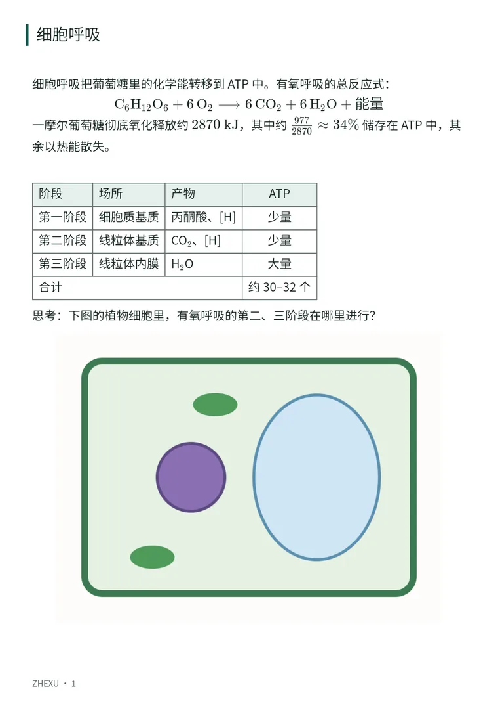
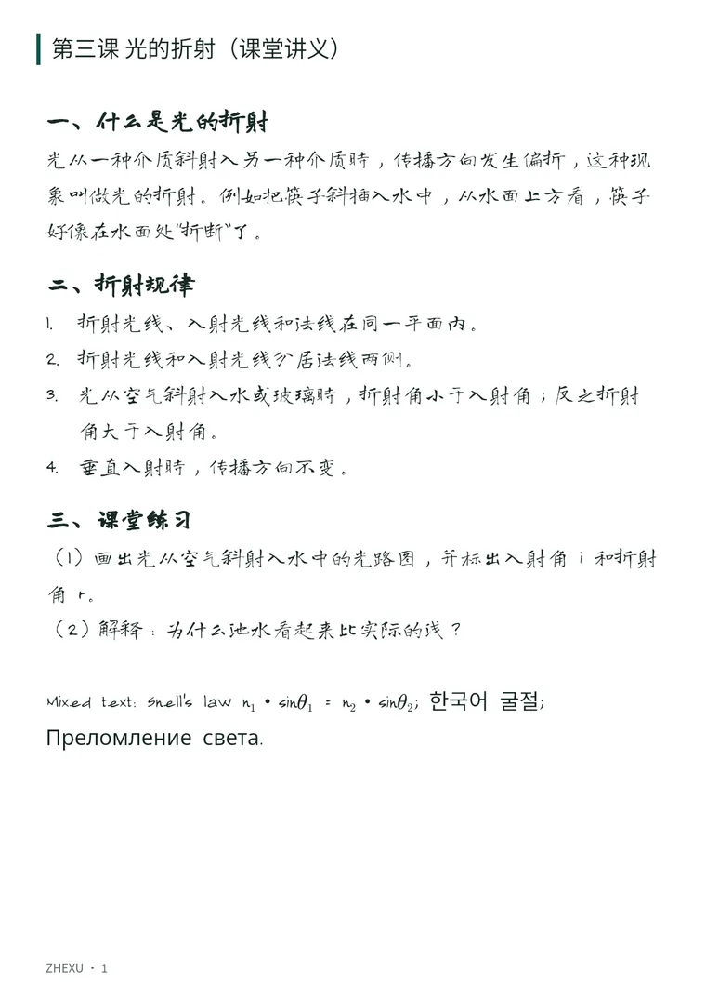
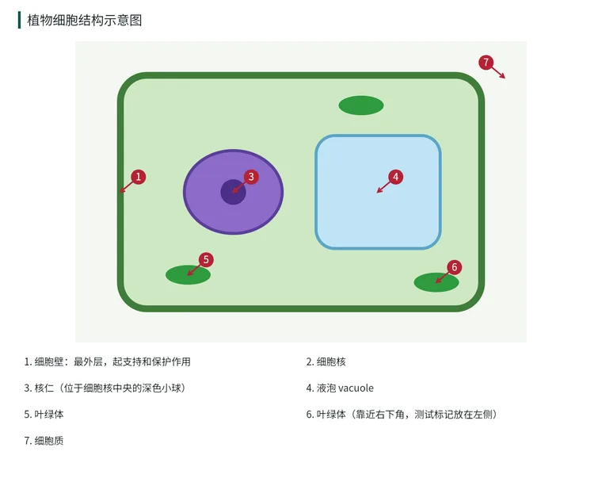

# 折序 ZHEXU

**One sentence, unfolded into a lesson.**

ZHEXU is an open-source AI classroom. Say what you want to learn: it plans an outline, builds the pages, then an AI teacher explains them and AI classmates discuss them with you.

English | [简体中文](/.github/README-zh.md)

[](https://github.com/miscos330/zhexu/actions/workflows/zhexu-ci.yml)


## Built on OpenMAIC

ZHEXU is a downstream edition of [OpenMAIC](https://github.com/THU-MAIC/OpenMAIC), which the THU-MAIC team open-sourced under the MIT license. The classroom, the pages and the exports all come from upstream. This repository adds its own brand, theme and extensions on top. Improvements that are not specific to ZHEXU go back upstream instead of staying here.

This repository started as a GitHub fork of OpenMAIC and left the fork network on 2026-11-20, so that it shows up in search as a project of its own. Its history is unchanged, and upstream is still merged in the same way. Pull requests for upstream are now made from a separate fork, [miscos330/OpenMAIC](https://github.com/miscos330/OpenMAIC).

The upstream README is kept unchanged at the root of this repository. [README.md](/README.md) describes everything the classroom can do, with all of its setup options.

## Status

This is an early edition. The latest release candidate is [0.1.0-rc.2](https://github.com/miscos330/zhexu/releases/tag/zhexu-v0.1.0-rc.2), of 2026-11-21; what each release changes is in the [changelog](/extensions/zhexu/CHANGELOG.md).

Available now:

- **Classroom**: everything upstream OpenMAIC does.
- **Brand and theme**: the ZHEXU mark, colours and dark mode.
- **Extension layer**: new features live under [`extensions/`](/extensions/README.md) and are added with a few small hooks into upstream code, so upgrades stay easy.
- **A4 handouts**: the assistant hands an answer over as real files, an A4 PDF and page images, optionally in a Chinese handwriting face. [How it works](/extensions/README.md#a4-handouts-zhexu).
- **Image annotations**: the assistant looks at an image you attached and puts numbered labels on it, as an A4 PNG and PDF. The original image is kept unchanged. [How it works](/extensions/README.md#image-annotations-zhexu).
- **My files**: a page in the rail that lists the handouts and annotated images the assistant has delivered in your conversations, ready to download, older ones a page at a time. Available when either switch is on.
- **Course handouts**: export a course you have saved as an A4 handout: what is written on each page, the narration and the quiz questions in page order, with the answers on a page of their own at the end. The text is taken from the course as it is, not rewritten by a model. The quiz questions alone make a worksheet: a line for the name, class and date at the top, room to write under open questions, and the answers on their own page. It shares the switch of A4 handouts.
- **Typeset formulas**: LaTeX in a handout (`\(` `\)` inside a line, `\[` `\]` on a line of its own) and the formulas of a course are typeset, with the same layout and fonts as KaTeX gives them on a slide. A formula that cannot be drawn that way is printed as its LaTeX source. [How it works](/extensions/README.md#a4-handouts-zhexu).
- **Tables**: a Markdown pipe table in a handout, and a table of a course, is drawn ruled, with a shaded header row, aligned columns, long cells wrapped and merged cells drawn as one box; a long table repeats its header on each page. [How it works](/extensions/README.md#a4-handouts-zhexu).
- **Pictures**: a course's pictures are placed in its handout, read from the owner's course assets; nothing remote is fetched. A picture that cannot be placed leaves a visible note. [How it works](/extensions/README.md#a4-handouts-zhexu).
- **Interactive and project pages**: a course's interactive page gives a handout what its widget explains (the concept or task, the description, the steps, the nodes of a diagram); a project page its description, learning objective, milestones and tasks. The page's program is not printed.

They are off until their switch is set (`ZHEXU_DELIVERABLES_ENABLED`, `ZHEXU_IMAGE_ANNOTATIONS_ENABLED`). They are covered by unit tests and by [browser tests](/extensions/zhexu/e2e/README.md) that CI runs end to end against a production build and against the Docker image, with a scripted stand-in for the model. They have not been run with a real model yet.

| Formulas, a table and a picture | The handwriting face | An annotated image |
| --- | --- | --- |
|  |  |  |

These three pages are real output of the renderer, made from test content. The first is rendered by [`zhexu-sample-handouts.test.ts`](/tests/extensions/zhexu-sample-handouts.test.ts) when `ZHEXU_RENDER_SAMPLES=1` is set.

Planned:

- **Markdown in handouts**: headings, emphasis and lists that the assistant writes in Markdown are printed as written for now; the plan is to set them as headings, bold text and lists.

The direction is printable material for teachers, which is where ZHEXU differs from upstream.

What the extension does not reach yet is listed in [`extensions/README.md`](/extensions/README.md#not-covered-yet).

## Run it locally

You need Node.js 22.19 or later, pnpm 10 and PostgreSQL 16.

```bash
git clone https://github.com/miscos330/zhexu.git zhexu
cd zhexu
pnpm install
cp .env.example .env.local            # API keys and server options
cp openmaic.example.yml openmaic.yml  # which models the server uses
pnpm db:up                            # a development PostgreSQL in Docker; skip it if you have one
```

In `.env.local`, set a model key and `DATABASE_URL`, then add the three lines that turn ZHEXU on:

```env
NEXT_PUBLIC_DEPLOYMENT_EXTENSION=zhexu
NEXT_PUBLIC_WORKBENCH_ENABLED=true
OPENMAIC_AGENT_RUNTIME_ENABLED=true
```

```bash
pnpm dev
```

Open <http://localhost:3000>. The brand and the extension's entries show in the workbench, which is why the last two lines are needed. Without `NEXT_PUBLIC_DEPLOYMENT_EXTENSION` the app is exactly upstream OpenMAIC.

Models, Docker and the other options are covered in the upstream [Quick Start](/README.md#-quick-start). A Docker build includes the extension when `NEXT_PUBLIC_DEPLOYMENT_EXTENSION=zhexu` and `NEXT_PUBLIC_WORKBENCH_ENABLED=true` are passed as build arguments.

## What this repository adds

| Path | What it is |
| --- | --- |
| [`extensions/`](/extensions/README.md) | The extension layer: which extension is active, and how one changes the brand, the theme and the workspace shell |
| [`extensions/zhexu/`](/extensions/zhexu) | The ZHEXU extension: brand, theme, an about page, A4 handouts and image annotations |
| [`extensions/zhexu/site/`](/extensions/zhexu/site/README.md) | A static showcase page with no build step. Preview it with `node extensions/zhexu/site/tools/serve.mjs` |
| [`public/extensions/zhexu/`](/public/extensions/zhexu) | Brand assets and where they come from |
| [`tests/extensions/`](/tests/extensions) | Tests for all of the above |
| [`.github/workflows/zhexu-ci.yml`](/.github/workflows/zhexu-ci.yml) | The checks that run on this branch |

Six upstream files are touched, each by a few lines: `app/layout.tsx` mounts the extension, `lib/server/agent-runtime/runner.ts` adds the extension's tools to a run, `components/workbench/chat/action-cluster.tsx` shows its cards in the conversation, `lib/i18n/load-resource.ts` puts the product name into upstream's strings, `app/classic-home.tsx` takes its logo from the brand, and `.env.example` documents the switches. `Dockerfile` and `docker-compose.yml` take the extension as one more build argument. The issue forms under `.github/ISSUE_TEMPLATE/` are changed as well, so that an issue opened here is about this repository and anything else is pointed upstream.

## Branches

- `zhexu` is the default branch and carries this edition.
- `main` mirrors upstream. Upstream changes are merged into `zhexu`, which is never rebased.

## Contributing

An improvement that is not specific to ZHEXU belongs upstream, where everyone gets it. OpenMAIC's [CONTRIBUTING.md](/CONTRIBUTING.md) says how. Changes to the extension, the theme or the showcase page are welcome here as pull requests against `zhexu`, and problems with them as issues in this repository. Taking part here follows the [code of conduct](/.github/CODE_OF_CONDUCT.md).

What this repository has sent upstream so far (status as of 2026-11-20):

- [#2286](https://github.com/THU-MAIC/OpenMAIC/pull/2286), pull request, merged on 2026-11-17: six test files that failed on Windows.
- [#2355](https://github.com/THU-MAIC/OpenMAIC/pull/2355), pull request, merged on 2026-11-20: skip the sandbox shell and Python tests on Windows, which need a POSIX system.
- [#2285](https://github.com/THU-MAIC/OpenMAIC/issues/2285), bug report, accepted by a maintainer: the standalone build output included the whole repository.
- [#2306](https://github.com/THU-MAIC/OpenMAIC/discussions/2306), idea, open: let a deployment change the workbench accent colour.

## License

MIT, the same as upstream. The original THU-MAIC copyright notice is kept. See [LICENSE](/LICENSE).
